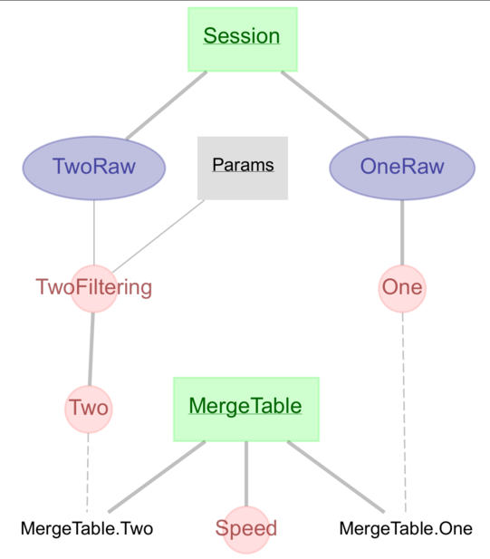

# Merge Tables

## Why

A pipeline may diverge to process the same data in different ways. A Merge Table
joins the divergent pipelines, so downstream steps read from one table. For a
longer discussion, see
[this notebook](https://github.com/ttngu207/db-programming-with-datajoint/blob/master/notebooks/pipelines_merging_design_master_part.ipynb)
and related discussions
[here](https://github.com/datajoint/datajoint-python/issues/151) and
[here](https://github.com/LorenFrankLab/spyglass/issues/469).

## Version Support Policy

Pipelines are periodically rewritten as new major versions, such as
`SpikeSortingV0` and `SpikeSortingV1` today, with `PositionV2` and
`SpikeSortingV2` anticipated. Merge Tables such as `PositionOutput` and
`SpikeSortingOutput` let old and new versions coexist and be queried
interchangeably while users migrate.

When a new version `VX` is released, the previous version `VX-1` is supported as
follows:

- **Installation**: `VX-1` is no longer supported for installation once `VX` is
    released.
- **Data access**: Data generated with `VX-1` will always remain accessible. Use
    it with caution after 12 months, as it will no longer reflect ongoing
    improvements to the pipeline.
- **Bug fixes**: After 12 months, the Spyglass team no longer issues bug fixes
    for `VX-1`. Affected users are welcome to submit a pull request.
- **Insert tools**: After 12 months, the tools used to insert new `VX-1` entries
    are removed. Fetch methods are retained so that existing data remains
    accessible.

## What

A Merge Table is a master table with one part for each divergent pipeline. By
convention:

1. The master table has one primary key, `merge_id`, a
    [UUID](https://en.wikipedia.org/wiki/Universally_unique_identifier), and
    one secondary attribute, `source`, which gives the part table name. Both
    are managed by this class's `insert`.

2. Each part table inherits the final table of its pipeline, and takes that
    table's name.

```python
from spyglass.utils.dj_merge_tables import _Merge


@schema
class MergeOutput(_Merge):
    definition = """
    merge_id: uuid
    ---
    source: varchar(32)
    """

    class One(dj.Part):
        definition = """
        -> master
        ---
        -> One
        """

    class Two(dj.Part):
        definition = """
        -> master
        ---
        -> Two
        """
```



Merge Tables are named for the pipeline plus `Output`, such as `LFPOutput` and
`PositionOutput`. Import the class as `_Merge`, which keeps DataJoint from
reading it as a table to declare.

## How

### Merging

`Merge` subclasses DataJoint's
[Manual Table](https://datajoint.com/docs/core/design/tables/tiers/#data-entry-lookup-and-manual)
and adds the methods below. The [API reference](../api/utils/dj_merge_tables.md)
gives their full signatures, under `utils.dj_merge_tables`.

Call these methods on an instance, `MergeTable()`. Restricting with `&` returns
one, so `(MergeTable & restriction).fetch()` works as written.

### Populating

`populate()` takes a restriction, populates the source tables it applies to, and
inserts the new keys into the matching parts:

```python
# Populate every source
MergeTable().populate()

# Populate the sources this restriction applies to
MergeTable().populate({"nwb_file_name": "my_session.nwb"})

# Populate one source
MergeTable().populate({"source": "MyPart"})
```

It returns the rows inserted, keyed by source name. A source is skipped when the
restriction names a column it does not have, and when it takes direct inserts
rather than being populated.

!!! note "Inserting directly"

    Use `insert` for rows already present in a source table. `populate` is for rows
    that do not exist yet.

### Restricting

Restrict a Merge Table with the standard `&` operator. Part-table fields are
resolved automatically:

```python
# Restrict by a part-table field
result = MergeTable & {"nwb_file_name": "my_session.nwb"}
len(result)  # rows whose part has nwb_file_name == "my_session.nwb"

# Restrict by the master primary key
result = MergeTable & {"merge_id": some_uuid}
```

A dict key that no table has is dropped, as DataJoint does, so a full upstream
`key` restricts by the fields the Merge Table shares with it. A dict with no
known key at all raises.

!!! note "Stored restrictions"

    `&` resolves part-table fields when it is evaluated, so a stored query is a
    snapshot. Re-apply the restriction to pick up rows inserted since.

!!! note "String restrictions"

    Both dict and string restrictions resolve through parts automatically when the
    restriction references a part-table field name:

    ```python
    # These are equivalent:
    MergeTable & {"nwb_file_name": "session.nwb"}
    MergeTable & 'nwb_file_name LIKE "session%"'
    ```

    String restrictions on master-only fields (`merge_id`, `source`) are passed
    through to DataJoint directly without part-table resolution.

    Column names are read with DataJoint's own SQL parser, so `NOT IN`, `BETWEEN`,
    backtick-quoted names and function calls such as `lower(field) =` all resolve
    through parts. A restriction naming no known column raises; an unknown name
    alongside a known one is left to DataJoint, as with dict keys.

    A string restriction applies to the parts that have the named column; parts
    without it are dropped. This differs from `dj.Not` on a dict, which returns the
    set complement.

!!! note "Composite and negated restrictions"

    Lists, `dj.AndList` and `dj.Not` resolve through parts the same way a bare dict
    does, and a dict is applied only to the parts that have its columns:

    ```python
    MergeTable & {"part_field": 1}  # equivalent
    MergeTable & [{"part_field": 1}]  # equivalent
    ```

    `dj.Not` on a part-table field returns the set complement, so parts without that
    field contribute all of their rows:

    ```python
    len(MergeTable & r) + len(MergeTable & dj.Not(r)) == len(MergeTable)
    ```

!!! note "Raw master-only restriction"

    To restrict on `merge_id` or `source` without part-table resolution, use
    `super_restrict()`:

    ```python
    MergeTable().super_restrict({"source": "MyPart"})
    ```

### Fetching

`fetch()` and `fetch1()` read the master joined to its parts, so one call can
name master and part fields together:

```python
# A part-table field
(MergeTable & restriction).fetch("nwb_file_name")

# Master and part fields in one call
(MergeTable & restriction).fetch("source", "nwb_file_name")

# fetch1(): a dict for no fields, a scalar for one, a tuple for several
(MergeTable & restriction).fetch1()
(MergeTable & restriction).fetch1("nwb_file_name")
(MergeTable & restriction).fetch1("a", "b")

# limit, offset and order_by apply to the whole result
MergeTable().fetch("nwb_file_name", order_by="nwb_file_name", limit=5)

# Master columns only, without part resolution
MergeTable().super_fetch()
```

Naming no fields returns every column of every part, plus `source`. A column a
part does not have reads as `NULL`, or `0` when numeric.

For other output shapes, pass `as_dict` or `format` to `fetch()`. `fetch1()`
rejects them.

### Viewing

```python
# Merged preview of all parts, as a string
(MergeTable & restriction).view()

# The same as HTML, for notebooks
(MergeTable & restriction).html()

# Master columns only
MergeTable().super_view()
```

When the restriction matches no part, `view()` returns `None` and `html()`
returns an empty marker.

### Selecting part and parent tables

```python
# The part tables for the current restriction, as a list
(MergeTable & restriction).get_part_table()

# With the master's columns, including source
(MergeTable & restriction).get_part_table(join_master=True)

# The upstream source table the data came from
(MergeTable & restriction).get_parent_table()
```

`get_part_table()` returns a list, as DataJoint's `parts()` does, and `[]` when
no part matches. `get_parent_table()` returns one table, and raises when the
restriction matches no part or more than one; pass `multi_source=True` for a
list.

### Deleting

```python
# Merge entries, master and parts
(MergeTable & restriction).delete()

# Upstream source rows, and the merge entries that cascade with them
(MergeTable & restriction).delete_upstream(dry_run=True)  # list the targets
(MergeTable & restriction).delete_upstream(dry_run=False)  # delete
```

`delete_upstream` deletes the source rows and lets DataJoint's cascade take the
merge entries, in one transaction behind one confirmation.

### Building Downstream

A downstream analysis will ideally be able to use all divergent pipelines
interchangeably. If there are parameters that may be required for downstream
processing, they should be included in the final table of the pipeline. In the
example above, both `One` and `Two` might have a secondary key `params`. A
downstream Computed table could do the following:

```python
def make(self, key):
    parent = (MergeTable & key).get_parent_table()
    try:
        params = parent.fetch("params")
    except DataJointError:
        params = default_params
    processed_data = self.processing_func(key, params)
```

`key` may carry fields belonging to this table rather than the Merge Table;
those are dropped from the restriction. Keep the restriction outside the `try`,
so a restriction error surfaces instead of falling through to `default_params`.

## Deprecated API

The following class methods are deprecated and will be removed in Spyglass
0.7.0. They continue to work but log a deprecation warning on first call.
Migrate to the instance-method equivalents shown in the table below.

| Deprecated call                                             | Replacement                                                |
| ----------------------------------------------------------- | ---------------------------------------------------------- |
| `MergeTable.merge_view(restriction)`                        | `(MergeTable & restriction).view()`                        |
| `MergeTable.merge_html(restriction)`                        | `(MergeTable & restriction).html()`                        |
| `MergeTable.merge_restrict(restriction)`                    | `MergeTable & restriction`                                 |
| `MergeTable.merge_delete(restriction)`                      | `(MergeTable & restriction).delete()`                      |
| `MergeTable.merge_delete_parent(restriction, dry_run=True)` | `(MergeTable & restriction).delete_upstream(dry_run=True)` |
| `MergeTable.merge_get_part(restriction, ...)`               | `(MergeTable & restriction).get_part_table(...)`           |
| `MergeTable.merge_get_parent(restriction, ...)`             | `(MergeTable & restriction).get_parent_table(...)`         |
| `MergeTable.merge_fetch(*attrs, restriction=...)`           | `(MergeTable & restriction).fetch(*attrs)`                 |
| `MergeTable.merge_populate(source, keys)`                   | `MergeTable.populate({"source": source}, keys)`            |

## Example

See the [Merge Tables notebook](../notebooks/04_Merge_Tables.ipynb).
