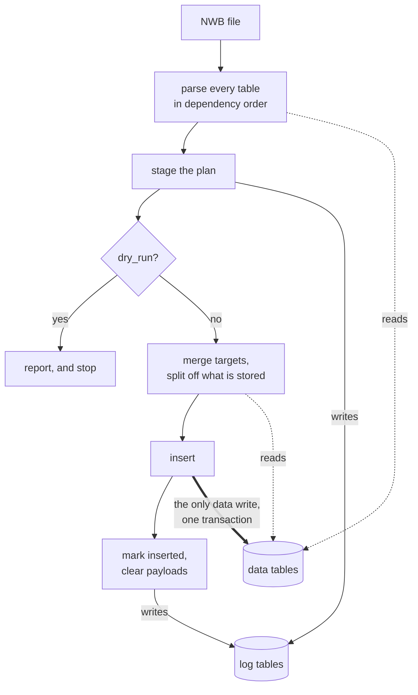

# Ingestion Plans

This article explains how Spyglass decides what an NWB file would insert
*before* inserting it, what the resulting report tells you, and how the
`IngestionPlanLog` tables replace `InsertError`.

## Why plans exist

`insert_sessions` used to stop at the first table that raised. Everything after
it went uningested, the tables before it were already written, and the only
record was one `InsertError` row per exception — with no memory of what had been
staged. Fixing the file meant starting over and paying for the whole parse
again.

A *plan* is the parse without the insert. Spyglass reads the file once, works
out every row each table would write, checks those rows for problems, and
reports all of them together. Nothing is written, so a file with five errors
tells you about five errors instead of the first one.

## The shape of an ingestion

Two passes. The first reads the database but writes only to the log tables, so
it is where `dry_run` stops. The second writes the rows the first already
checked, in a single transaction — the only moment any data table is written.



Because both passes share one parse, what a dry run reports is what a real run
does. The insert re-derives nothing: no file is reopened and no mapping re-run.

## Checking a file before you ingest it

Pass `dry_run=True` to either entry point. Spyglass plans the file, prints the
report, and writes nothing to any data table:

```python
from spyglass.data_import import insert_sessions

plan = insert_sessions("minirec20230622.nwb", dry_run=True)[0]
if plan:  # truthy means something blocked
    print(plan)
```

This works whether or not Spyglass has seen the file before. A file already in
`Nwbfile` is planned from its `_.nwb` copy; a file it has never seen is planned
from the **raw** file, keyed by the `_.nwb` name ingestion would give it, with
foreign keys to `Nwbfile` resolving against the row ingestion would create.
Either way nothing is written — no copy, no `Nwbfile` row, no data table.

`populate_all_common(copy_file_name, dry_run=True)` does the same for one
already-registered file. Both return an `IngestionPlan`.

Every table is checked either way. Tables are planned in the order an insert
would run them, so one that needs a value from another table the same ingestion
fills — `SensorData` and `DIOEvents` want `Raw`'s interval, `VideoFile` wants
the task epochs — reads it from the plan rather than from a database that has
not been written yet.

## Ingesting from the plan

Ingestion checks the whole file first, then inserts what it checked:

```python
from spyglass.data_import import insert_sessions

plan = insert_sessions("minirec20230622.nwb")[0]
```

A blocking problem means **nothing is written** — the file is as it was, the
report names every problem at once, and a re-attempt skips whatever is already
stored.

`allow_partial=True` inserts the tables that planned cleanly even though others
did not. Off by default, so a half-ingested file is a choice rather than an
accident.

### When the file disagrees with a stored row

A planned entry whose primary key already exists with different values is a
**divergence** — a re-ingested camera whose manufacturer reads `manufacturer-1`
where the stored row says `manufacturer 1`.

Nothing stops to ask. The stored value is kept, the rest of the file ingests,
and the report names the row and the columns that differ along with the revision
that would align them. Read it after the run; the plan is staged, so it is still
there later.

## Planning a file directly

```python
from spyglass.data_import.planner import plan_nwbfile

plan = plan_nwbfile("minirec20230622_.nwb")
print(plan.report())
```

A clean plan is one line:

```text
minirec20230622_.nwb: no_op — already ingested, nothing to do
```

A plan with problems leads with the same verdict, then groups what it found by
severity, worst first. This is a real report, from a copy of the test file with
a camera device removed and one camera's manufacturer changed:

```text
docsdemo20230622_.nwb: partial_new — 190 new entries

New entries:
      4  `common_behav`.`_raw_position__pos_object`
      2  `common_behav`.`_raw_position`
      4  `common_behav`.`position_source__spatial_series`
      2  `common_behav`.`position_source`
      3  `common_dio`.`_d_i_o_events`
     32  `common_ephys`.`_electrode_group`
    128  `common_ephys`.`_electrode`
      1  `common_ephys`.`_raw`
      1  `common_ephys`.`_sample_count`
      6  `common_interval`.`interval_list`
      1  `common_sensors`.`_sensor_data`
      1  `common_session`.`_session__data_acquisition_device`
      2  `common_session`.`_session__experimenter`
      1  `common_session`.`_session`
      1  `lfp_electrode`.`l_f_p_electrode_group`
      1  `lfp_imported`.`_imported_l_f_p`

Disagrees with stored rows (1):
  `common_device`.`camera_device` (1):
    {'camera_name': 'test camera 1'} exists with different values for ['manufacturer']
      stored values: {'manufacturer': 'Allied Vision'}
  -> The stored rows were kept. Edit the file to match, or update the rows, if the file is right.

Hard (1):
  [hard] `common_task`.`_task_epoch`: parse_error: No camera device found with ID [1] in NWB file docsdemo20230622_.nwb. Known camera IDs: [0]
      -> A table raised while parsing. The traceback names where.

Blocked by the above (3): `common_behav`.`_state_script_file`, `common_behav`.`_video_file`, `common_optogenetics`.`optogenetic_protocol`
```

One root cause, read top to bottom: the verdict says 190 entries would still be
written, the counts say which tables they belong to, the disagreement is
reported without stopping anything, and `TaskEpoch` failing accounts for the
three tables below it rather than producing three more problems.

Each problem names the NWB `object_id` where there is one, so you can find the
thing in the file. Each *code* gets a one-line remedy, printed once per group
rather than under every occurrence.

Disagreements get their own section because they do not stop anything: the
stored rows were kept and the rest of the file ingested. The verdict describes
what the run did, so one disagreement does not retitle a file that was otherwise
entirely new.

`report(verbose=True)` adds notes about things that were resolved. Warnings are
shown by default — a warning you have to ask for is not a warning.

### Verdicts

| Verdict       | Meaning                                  |
| ------------- | ---------------------------------------- |
| `fatal`       | The file could not be planned at all     |
| `no_op`       | Everything in the file is already stored |
| `all_new`     | Nothing in the file is stored yet        |
| `partial_new` | Some of it is stored; the rest is new    |

`fatal` is answered before the others. A file that could not be read plans no
entries, so counting them would say "nothing new" — which reads as *already
ingested*, the opposite of what happened.

### Blocked tables

A table whose parent could not be planned is reported once, at the end, as
blocked — not as a failure of its own. One root cause produces one problem,
rather than one per table downstream of it.

## The plan log

`common_usage.IngestionPlanLog` records a file's plan so a later attempt can see
what the last one achieved. It is a staging area for *incomplete* ingestion,
never a second copy of your data.

| Table                      | Holds                                                              |
| -------------------------- | ------------------------------------------------------------------ |
| `IngestionPlanLog`         | one live plan per file: verdict, status, attempt count, provenance |
| `IngestionPlanLog.Entry`   | one row per prospective entry, with its state and payload          |
| `IngestionPlanLog.Problem` | problems belonging to the file rather than to one entry            |

```python
from spyglass.common.common_usage import IngestionPlanLog

IngestionPlanLog & {"nwb_file_name": "minirec20230622_.nwb"}
IngestionPlanLog.Entry & {"nwb_file_name": "minirec20230622_.nwb"}
```

Each staged entry carries two hashes, which answer different questions:

- `key_hash` — of the entry's **primary key**. Its identity. A second attempt
    updates the row it already has rather than appending a duplicate, which is
    what lets attempt two stage N+M where attempt one staged N.
- `blob_hash` — of the **whole entry**. Its content. Same key with a different
    blob is a *divergence*, not a new row, and one hash could not tell those
    apart.

Entries keep their payload only while they are unstored. On full success they
are migrated to their real tables and the payload is cleared, leaving the hashes
behind as provenance. Storing your data twice is the failure this design exists
to avoid.

!!! note "The file hash is provenance, not a cache key"

    `nwb_hash` is recorded but never gates freshness. The expected workflow is
    ingest → read the report → **edit the file** → retry, so the file hash differs
    on every attempt by construction. Gating on it would discard the whole plan
    exactly when it is most useful. Validity is per entry.

    It is `NULL` for a file holding a very large dataset. Planning bounds how much
    of any one dataset it reads — hashing a multi-GB array to decide whether a parse
    can be reused costs more than the parse — and a partial read is not the file's
    hash, so none is recorded rather than a misleading one. `NwbfileHasher` without
    that bound, as analysis-file provenance uses it, is unaffected.

## Migrating from `InsertError`

`InsertError` still holds the rows earlier versions wrote, so existing queries
keep working — `fetch` warns once to say it is deprecated. Nothing writes to it
now. It recorded one row per exception with no memory of what was already
staged, which is what `IngestionPlanLog` replaces.

| Instead of                              | Use                                                  |
| --------------------------------------- | ---------------------------------------------------- |
| `InsertError & {"nwb_file_name": name}` | `IngestionPlanLog.Problem & {"nwb_file_name": name}` |
| reading `error_message` per row         | `plan.report()`                                      |
| checking whether the list is empty      | the returned result is falsy when clean              |

The value returned by ingestion is the `IngestionPlan` itself. It is falsy when
nothing blocked, iterates over the blocking problems, and prints as the report,
so code written against the old error list keeps working:

```python
result = ...  # returned by ingestion
if result:  # same test as before
    print(result)  # now prints the full report
    for problem in result:  # iterates blocking problems
        print(problem.code, problem.table)
```
