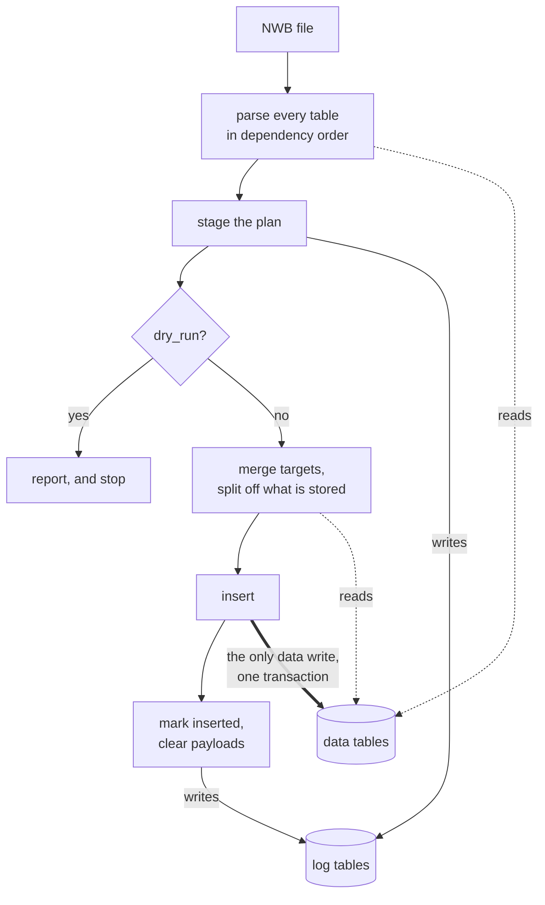

# Ingestion Plans

An NWB ingestion is run in two passes.

1. Parse the file, log errors, and write a report.
2. Actually write to the data tables.

What a report *says* and how to act on it is user-facing, covered in
[Ingestion](../Features/Ingestion.md). Running it is the
[Insert Data tutorial](../notebooks/02_Insert_Data.ipynb).

## The two passes

The first pass reads the database but writes only to the log tables. If this is
a `dry_run`, it stops here. The second writes to the data tables in a single
transaction. Both passes share one parse, so what a dry run reports is what a
real run does.



Tables are parsed in dependency order, so a table needing a value from another
table the same ingestion fills reads it from the plan rather than from a
database that has not been written yet. `SensorData` and `DIOEvents` want
`Raw`'s interval, and `VideoFile` wants the task epochs. Foreign keys are
checked against `existing ∪ planned`.

## How to add a table

A `SpyglassIngestion` table declares what the ingestion process looks for in a
file with `_source_nwb_object_type`, optionally narrowed by
`_source_nwb_object_name` or `_source_nwb_object_description`. It then maps NWB
values onto its columns with `table_key_to_obj_attr`.

Parsing then runs these hooks, each documented on itself:

| Hook                 | Override to                                          |
| -------------------- | ---------------------------------------------------- |
| `before_parse`       | build the file-wide lookups the mapping needs        |
| `find_sources`       | choose the NWB objects, when the declarations cannot |
| `entries_for_source` | work at the level of a container…                    |
| `entries_for_row`    | …or of one row of a DynamicTable                     |

Every hook takes `ctx`, a `FileContext` created for one file and passed to each
hook in turn. It carries that file, the config it was given, the objects read so
far, and the problems found.

| On `ctx`              | Gives                                               |
| --------------------- | --------------------------------------------------- |
| `ctx.nwb_file`        | the open file, and `ctx.nwb_file_name` its name     |
| `ctx.config`          | the merged `_spyglass_config.yaml` and lab defaults |
| `ctx.rows_for(table)` | the rows a table will hold, planned and stored      |
| `ctx.problem(...)`    | records a problem against this table                |

Two rules the hook docstrings assume:

- **File-wide lookups belong on `ctx`.** Some tables need a whole-file answer
    before they can map a single row (e.g., `TaskEpoch` needs every camera's
    name). Build it once in `before_parse` and preserve in `ctx`. If clearing,
    do so here, rather than `insert_from_nwbfile`.
- **A problem is recorded, not raised.** `ctx.problem(...)` gathers issues. We
    don't raise so that the report accumulates everything.

<!-- TODO: Deprecate this after tables moved to new contract -->

`generate_entries_from_nwb_object` and `get_nwb_objects` are a compatibility
shim for tables written against the older contract. They still work, because the
shim hands a legacy override its context and handles row expansion, so there is
no deadline to convert.

## Skipping work on a retry

The user workflow is...

1. Run ingestion
2. Read the report
3. Optionally, edit the file and try again

Reusing a plan is per table and judged on what that table actually read. An
issue with any of the following negates a previous report.

| Gate              | Covers                                                                                 |
| ----------------- | -------------------------------------------------------------------------------------- |
| Spyglass version  | ingestion code itself changed                                                          |
| `id_set_digest`   | the *set* of NWB object ids, the only thing that notices an object having **appeared** |
| `read_set_digest` | the contents of individual objects that table read                                     |
| `xrefs`           | values it resolved out of other tables, which the file cannot see change               |

`read_set_digest` is `NULL` when the file could not be hashed. That reads as
*unknown*, never as *unchanged*: reuse has to be provably safe, while re-parsing
is only slow.

## The plan log

`common_usage.IngestionPlanLog` records a file's plan so a reattempt can see
what the last one achieved. It is a staging area for *incomplete* ingestion.
Subsequent attempt update in-place, rather than preserving outdated plans.

| Table                      | Holds                                                              |
| -------------------------- | ------------------------------------------------------------------ |
| `IngestionPlanLog`         | one live plan per file: verdict, status, attempt count, provenance |
| `IngestionPlanLog.Entry`   | one row per prospective entry, with its state and payload          |
| `IngestionPlanLog.Table`   | one row per table: status, read-set digest, cross-references       |
| `IngestionPlanLog.Problem` | problems belonging to the file rather than to one entry            |

```python
from spyglass.common.common_usage import IngestionPlanLog

IngestionPlanLog & {"nwb_file_name": "minirec20230622_.nwb"}
IngestionPlanLog.Entry & {"nwb_file_name": "minirec20230622_.nwb"}
```

Each staged entry carries two hashes, which answer different questions:

- `key_hash`, of the entry's **primary key**
- `blob_hash`, of the **whole entry**

Entries keep their payload only while they are unstored. On full success they
are migrated to their real tables and the payload is cleared, leaving the hashes
behind as provenance.

## Planning a file directly

`plan_nwbfile` is the pass without the insert, for when you want the plan object
rather than a report:

```python
from spyglass.data_import.planner import plan_nwbfile

plan = plan_nwbfile("minirec20230622_.nwb")
plan.verdict  # what an ingest would do
plan.blocking  # the problems that stop work
plan.report()  # render; log_report() also emits
```

`force_replan=True` parses every table even where a staged plan could be reused.
Use if the plan seems to cause errors.

### Coming from `InsertError`

`InsertError` is a read-only shim: it still holds the rows earlier versions
wrote, so existing queries keep working, and `fetch` warns once to say it is
deprecated. Nothing writes to it.
