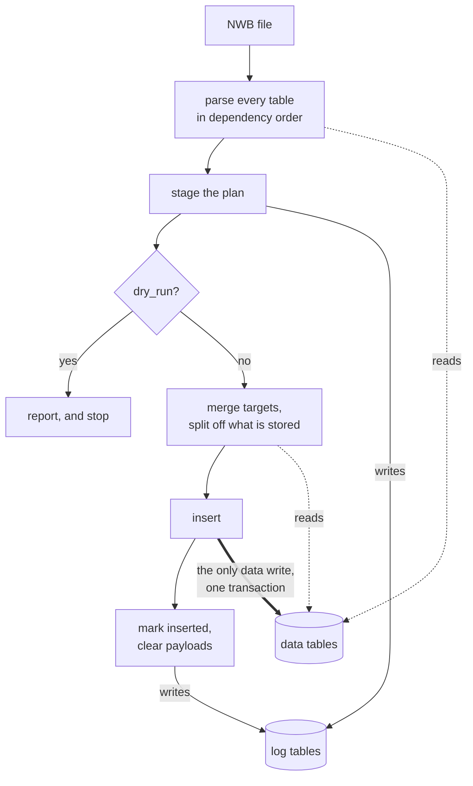

# Ingestion Plans

How ingestion is arranged internally: the two passes, how a table joins in, what
lets a second attempt skip work, and what the plan log stores.

What a report *says* and how to act on it is user-facing, covered in
[Ingestion](../Features/Ingestion.md). Running it is the
[Insert Data tutorial](../notebooks/02_Insert_Data.ipynb). Neither is repeated
here.

## The two passes

The first pass reads the database but writes only to the log tables, so it is
where `dry_run` stops. The second writes the rows the first already checked, in
a single transaction. That is the only moment any data table is written.



Both passes share one parse, so what a dry run reports is what a real run does.
The insert re-derives nothing: no file is reopened and no mapping is re-run. A
row that is wrong at insert time means the *plan* was wrong, which is a planner
gap rather than an ingestion error.

Tables are parsed in dependency order, so a table needing a value from another
table the same ingestion fills reads it from the plan rather than from a
database that has not been written yet. `SensorData` and `DIOEvents` want
`Raw`'s interval, and `VideoFile` wants the task epochs. Foreign keys are
checked against `existing ∪ planned`, which is why a table that emits its
parent's rows alongside its own does not look broken.

## How a table joins in

An ingestion table subclasses `SpyglassIngestion` and declares what to look for
with `_source_nwb_object_type`, optionally narrowed by `_source_nwb_object_name`
or `_source_nwb_object_description`. It then maps NWB values onto its columns
with `table_key_to_obj_attr`.

Parsing then runs these hooks, each taking the file context and documented on
itself:

| Hook                 | Override to                                          |
| -------------------- | ---------------------------------------------------- |
| `before_parse`       | reset any per-file state the table caches            |
| `find_sources`       | choose the NWB objects, when the declarations cannot |
| `entries_for_source` | work at the level of a container…                    |
| `entries_for_row`    | …or of one row of a DynamicTable                     |

Two rules the hook docstrings assume rather than state:

- **Per-file state is reset in `before_parse`, never in `insert_from_nwbfile`.**
    Planning and inserting share the parse but not `insert_from_nwbfile`, so a
    reset placed there never runs for a plan, and one instance serves every file
    a `populate` loops over.
- **A problem is recorded, not raised.** `ctx.problem(...)` accumulates a
    report; raising stops the file at one table, which is the behaviour plans
    exist to remove. A table that cannot find what it needs says so and lets the
    rest of the file plan.

`generate_entries_from_nwb_object` and `get_nwb_objects` are a compatibility
shim for tables written against the older contract. They still work, because the
shim hands a legacy override its context and handles row expansion, so there is
no deadline to convert.

## What lets a second attempt skip work

The workflow is ingest → read the report → edit the file → try again, so reuse
is per table and judged on what that table actually read. Three gates, and a
failure of any one re-parses:

| Gate              | Covers                                                                                 |
| ----------------- | -------------------------------------------------------------------------------------- |
| Spyglass version  | ingestion code itself changed                                                          |
| `id_set_digest`   | the *set* of NWB object ids, the only thing that notices an object having **appeared** |
| `read_set_digest` | the contents of the objects that table read                                            |
| `xrefs`           | values it resolved out of other tables, which the file cannot see change               |

`read_set_digest` is `NULL` when the file could not be hashed. That reads as
*unknown*, never as *unchanged*: reuse has to be provably safe, while re-parsing
is only slow.

## The plan log

`common_usage.IngestionPlanLog` records a file's plan so a later attempt can see
what the last one achieved. It is a staging area for *incomplete* ingestion,
never a second copy of your data.

| Table                      | Holds                                                              |
| -------------------------- | ------------------------------------------------------------------ |
| `IngestionPlanLog`         | one live plan per file: verdict, status, attempt count, provenance |
| `IngestionPlanLog.Entry`   | one row per prospective entry, with its state and payload          |
| `IngestionPlanLog.Table`   | one row per table: status, read-set digest, cross-references       |
| `IngestionPlanLog.Problem` | problems belonging to the file rather than to one entry            |

```python
from spyglass.common.common_usage import IngestionPlanLog

IngestionPlanLog & {"nwb_file_name": "minirec20230622_.nwb"}
IngestionPlanLog.Entry & {"nwb_file_name": "minirec20230622_.nwb"}
```

Each staged entry carries two hashes, which answer different questions:

- `key_hash`, of the entry's **primary key**. Its identity. A second attempt
    updates the row it already has rather than appending a duplicate, which is
    what lets attempt two stage N+M where attempt one staged N.
- `blob_hash`, of the **whole entry**. Its content. Same key with a different
    blob is a *divergence*, not a new row, and one hash could not tell those
    apart.

Entries keep their payload only while they are unstored. On full success they
are migrated to their real tables and the payload is cleared, leaving the hashes
behind as provenance. Storing your data twice is the failure this design exists
to avoid.

### The file hash is provenance, not a cache key

`nwb_hash` is recorded but never gates freshness. The workflow edits the file
between attempts, so the file hash differs every time by construction; gating on
it would discard the whole plan exactly when it is most useful.

It is `NULL` for a file holding a very large dataset. Planning bounds how much
of any one dataset it reads, because hashing a multi-GB array to decide whether
a parse can be reused costs more than the parse. A partial read is not the
file's hash, so none is recorded rather than a misleading one. `NwbfileHasher`
without that bound, as analysis-file provenance uses it, is unaffected.

## Planning a file directly

`plan_nwbfile` is the pass without the insert, for when you want the plan object
rather than a report:

```python
from spyglass.data_import.planner import plan_nwbfile

plan = plan_nwbfile("minirec20230622_.nwb")
plan.verdict  # what an ingest would do
plan.blocking  # the problems that stop work
plan.report()  # render; log_report() also emits
```

`force_replan=True` parses every table even where a staged plan says nothing it
read has changed. Reach for it when the suspicion is the reuse check itself.

### Coming from `InsertError`

`InsertError` is a read-only shim: it still holds the rows earlier versions
wrote, so existing queries keep working, and `fetch` warns once to say it is
deprecated. Nothing writes to it.

| Instead of                              | Use                                                  |
| --------------------------------------- | ---------------------------------------------------- |
| `InsertError & {"nwb_file_name": name}` | `IngestionPlanLog.Problem & {"nwb_file_name": name}` |
| reading `error_message` per row         | `plan.report()`                                      |
| checking whether the list is empty      | the result is falsy when clean                       |
